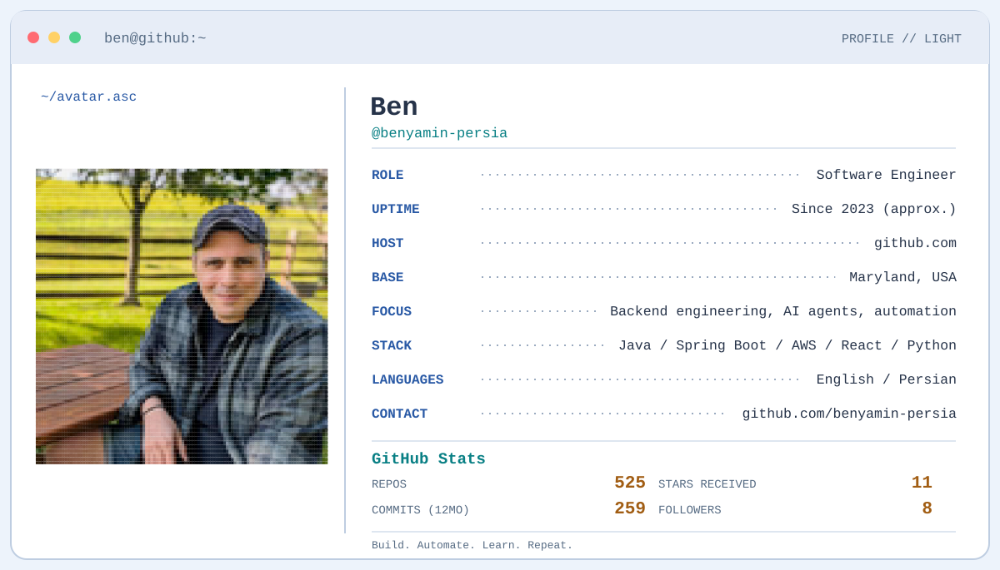

# Ben `~/github`

<picture>
  <source media="(prefers-color-scheme: dark)" srcset="https://raw.githubusercontent.com/benyamin-persia/benyamin-persia/main/assets/dark_mode.svg">
  <source media="(prefers-color-scheme: light)" srcset="https://raw.githubusercontent.com/benyamin-persia/benyamin-persia/main/assets/light_mode.svg">
  
</picture>

Software engineering • automation • AI agents

---

### About this profile

- **Two themes:** the card automatically follows the reader's GitHub dark/light theme.
- **Editable details:** edit [`config.json`](./config.json) to change the displayed text.
- **ASCII portrait:** edit [`portrait.txt`](./portrait.txt) to adjust the artwork.
- **Live public GitHub stats:** [`scripts/build_profile.py`](./scripts/build_profile.py) uses GitHub GraphQL to count owned public repositories, stars they received, commit contributions over the last 12 months, and followers.
- **Automatic refresh:** [GitHub Actions](./.github/workflows/update-profile.yml) refreshes the SVG cards daily and whenever the source files change. No separate secret or third-party Python package is required.

**Edit this card:** Change `config.json`, commit it, and the workflow will regenerate both cards. To refresh immediately, open the repository's **Actions** tab, select **Refresh GitHub terminal profile**, and use **Run workflow**.

*No employer affiliation or private email address is included.*
